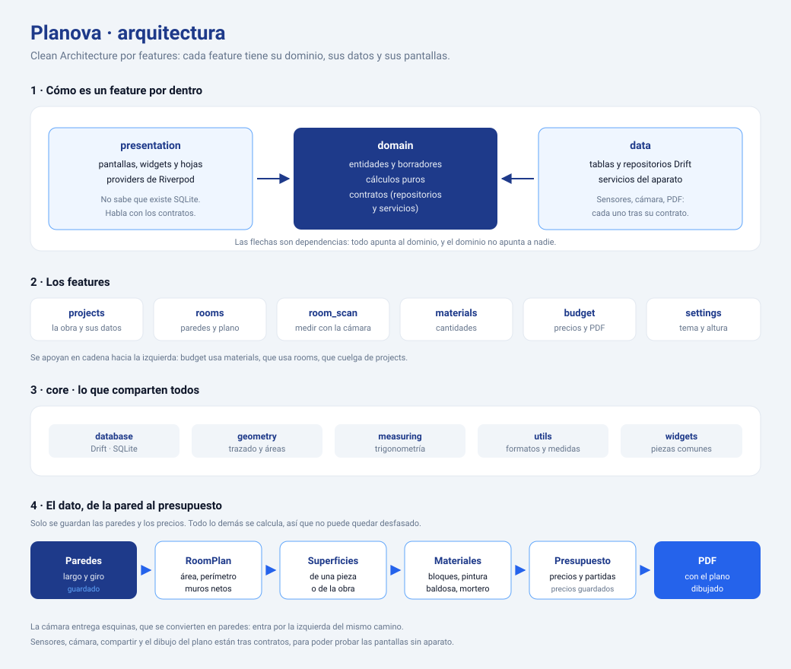

# Planova

App de Android para levantar el plano de una obra y saber qué cuesta.

Mides una habitación —a mano o apuntando con la cámara—, el plano se dibuja
solo, y de esas medidas salen los materiales y el presupuesto, que se envía al
cliente en PDF.

- **Proyectos**: cada obra con su cliente, dirección y notas.
- **Habitaciones y plano**: paredes con su largo y su giro, puertas y ventanas,
  área, perímetro y muros netos. El plano se toca para editar cada pared.
- **Medir con la cámara**: apuntas al pie de cada esquina y sale el polígono.
- **Materiales**: bloques, mortero (cemento y arena), pintura y baldosa, con
  los rendimientos de tu obra.
- **Presupuesto**: precio unitario a lo calculado, partidas a mano (acero,
  teja, mano de obra), total y costo por m².
- **PDF**: el presupuesto con el plano de cada habitación dibujado dentro.

## Arquitectura



Tres reglas sostienen todo lo demás:

1. **Las dependencias apuntan al dominio.** `presentation` y `data` conocen el
   dominio; el dominio no conoce a nadie. Las pantallas hablan con contratos
   (`ProjectRepository`, `RoomRepository`…), nunca con Drift.
2. **Lo que necesita el aparato vive tras un contrato.** Sensores, cámara,
   compartir el PDF y el dibujo del plano a imagen. Por eso las pantallas se
   prueban enteras sin teléfono: en las pruebas se sustituyen por dobles.
3. **Solo se guarda lo que el usuario escribe.** Paredes, vanos, rendimientos
   y precios. Áreas, cantidades y totales se calculan cada vez, así que un
   cambio en una pared se nota hasta en el PDF sin nada que sincronizar.

### Estructura

```
lib/
├── app/            arranque, rutas (GoRouter) y tema claro/oscuro
├── core/
│   ├── database/   base de datos Drift con las tablas de cada feature
│   ├── geometry/   trazado de paredes, área, distancias
│   ├── measuring/  trigonometría de la medición con la cámara
│   ├── utils/      formatos (metros, m², dinero) y lectura de medidas
│   └── widgets/    piezas compartidas
├── features/
│   ├── projects/   ┐
│   ├── rooms/      │  cada uno con
│   ├── room_scan/  │   domain/  entidades, cálculos y contratos
│   ├── materials/  │   data/    tablas, repositorios y servicios
│   ├── budget/     │   presentation/ pantallas, widgets y providers
│   └── settings/   ┘
└── main.dart

test/
├── unit/    geometría, medición, materiales, presupuesto y PDF
├── widget/  pantallas de punta a punta
└── fakes/   repositorios y servicios de mentira
```

Los nombres del código van en inglés; los textos de la app, en español.

## Cómo se trabaja

```bash
flutter pub get
dart run build_runner build   # genera el código de Drift
flutter run
```

Después de tocar una tabla de Drift hay que volver a generar. La base de datos
va por la **versión 4**; cada tabla nueva se añade con su migración en
[`app_database.dart`](lib/core/database/app_database.dart).

```bash
flutter test            # 69 pruebas
flutter analyze
flutter build apk --debug
```

## Medir con la cámara

La parte más delicada, y la que más se ha rehecho probándola en obra:

- La orientación sale de la **fusión de sensores de Android** (el vector de
  rotación, por canal nativo). Integrar el giroscopio a mano deriva en
  segundos y las esquinas marcadas se van de sitio; hay respaldo al
  giroscopio para aparatos sin ese sensor.
- El ángulo que abarca la cámara se le pregunta al sistema (Camera2), no se
  estima, y la imagen se enseña **entera** para que el dibujo encaje con ella.
- Las esquinas se guardan en **coordenadas de la habitación**, no respecto a
  quien mide, así que se puede caminar: con «Me moví» se apunta a una esquina
  ya marcada y la app vuelve a situarse.

## Lo que falta

Probar en el teléfono que las esquinas se quedan quietas al girar y al
caminar. Si el dibujo cayera corrido respecto a la pared real, el número a
revisar es el ángulo de la cámara en
[`view_projection.dart`](lib/core/measuring/view_projection.dart).

## Hecho con

Flutter 3.47 · Riverpod 3 · GoRouter 18 · Drift sobre SQLite · camera ·
sensors_plus · pdf y printing.
